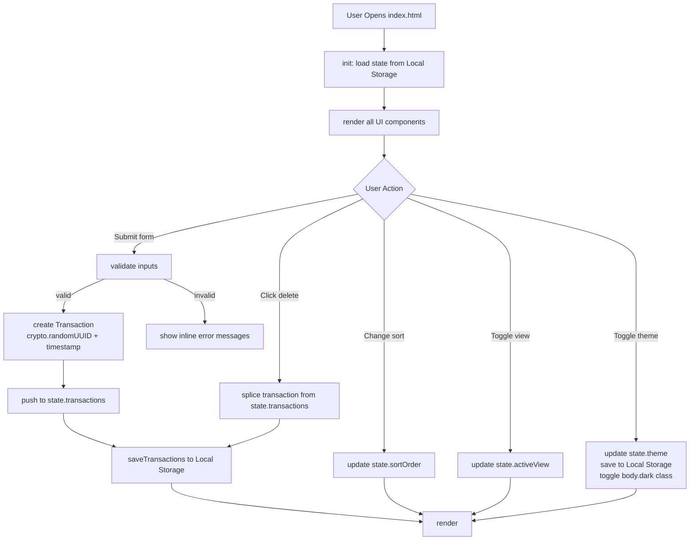

# Design Document

## Expense & Budget Visualizer

---

## Overview

The Expense & Budget Visualizer is a fully client-side, single-page web application (SPA) built with plain HTML, CSS, and Vanilla JavaScript. There is no server, no build step, and no JavaScript framework. A user opens `index.html` in any modern browser and the app is ready.

The app lets users:

- Record expense transactions (name, amount, category).
- See their total balance at a glance.
- Explore spending by category via a Chart.js pie chart.
- Sort the transaction list by newest, amount, or category.
- View a monthly summary of spending.
- Switch between light and dark themes.
- Have all data survive a page refresh via Local Storage.

The codebase is intentionally beginner-friendly: one HTML file, one CSS file, one JavaScript file, CDN-hosted Chart.js, and thorough inline comments throughout.

---

## Architecture

### File Structure

```
project-root/
├── index.html          ← single entry point, loads CSS + JS + Chart.js CDN
├── css/
│   └── style.css       ← all styling, CSS custom properties for theming
└── js/
    └── app.js          ← all application logic
```

> **Note on `.kiro/`:** The repository also contains a `.kiro/` directory that holds specification files (requirements, design, tasks). This directory is part of the development process, not the application source. It is never loaded by `index.html` and should not be confused with application code. The three application source files are solely `index.html`, `css/style.css`, and `js/app.js`.

### High-Level Data Flow

```
User Action
    │
    ▼
Event Handler (in app.js)
    │
    ▼
Mutate State Object
    │
    ├──► Storage_Manager.save()  ──► Local Storage
    │
    └──► render()
              │
              ├──► renderTransactionList()
              ├──► renderBalance()
              ├──► renderChart()
              └──► renderMonthlySummary()
```

Every state change follows the same three-step pattern: **Mutate → Persist → Render**. The `render()` function always reads from the in-memory state object — it never reads from Local Storage directly.

### Architecture Diagram



---

## Components and Interfaces

### HTML Sections

| Section ID | Purpose |
|---|---|
| `#app-header` | App title and theme toggle button |
| `#storage-warning` | Hidden by default; shown as non-blocking banner when Local Storage write fails |
| `#view-toggle` | Buttons to switch between Transaction List view and Monthly Summary view |
| `#transaction-list-view` | Contains input form, total balance, sort control, transaction list, and pie chart |
| `#input-form` | Item Name field, Amount field, Category dropdown, Add Expense button |
| `#total-balance` | Displays the running total balance |
| `#sort-control` | Dropdown for selecting sort order |
| `#transaction-list` | `<ul>` rendered by the Renderer; shows all transactions or an empty placeholder |
| `#chart-container` | Wraps the `<canvas>` for Chart.js and the "No data" message |
| `#monthly-summary-view` | Hidden by default; shows per-month totals or an empty placeholder |

### Form Layout and Error Placement

Each form field follows this HTML pattern so that error messages appear immediately below their field:

```html
<div class="form-group">
  <label for="item-name">Item Name</label>
  <input type="text" id="item-name" maxlength="100" />
  <span class="error-msg" id="name-error" aria-live="polite"></span>
</div>

<div class="form-group">
  <label for="amount">Amount</label>
  <input type="number" id="amount" min="0.01" step="any" />
  <span class="error-msg" id="amount-error" aria-live="polite"></span>
</div>

<div class="form-group">
  <label for="category">Category</label>
  <select id="category">
    <option value="">-- Select a category --</option>
    <option value="Food">Food</option>
    <option value="Transport">Transport</option>
    <option value="Fun">Fun</option>
  </select>
  <span class="error-msg" id="category-error" aria-live="polite"></span>
</div>
```

The `aria-live="polite"` attribute ensures screen readers announce errors when they appear.

---

## JavaScript Module Organization

`js/app.js` is a single file divided into clearly commented sections. Below is the layout with a description of each section's responsibility.

```
// ============================================================
// 1. CONSTANTS
// ============================================================
// Local Storage keys, category list, color map for chart, sort options.

// ============================================================
// 2. STATE
// ============================================================
// Single state object that holds all runtime data.

// ============================================================
// 3. STORAGE MANAGER
// ============================================================
// loadTransactions(), saveTransactions(), loadTheme(), saveTheme()
// Reads/writes to Local Storage. All try/catch error handling lives here.

// ============================================================
// 4. VALIDATOR
// ============================================================
// validateForm() — checks name, amount, category; returns error map.
// showErrors(errorMap) / clearErrors() — updates DOM error spans.

// ============================================================
// 5. KEY ALGORITHMS
// ============================================================
// getSortedTransactions(transactions, sortOrder)
// getChartData(transactions)
// groupByMonth(transactions)
// formatCurrency(amount)

// ============================================================
// 6. RENDERER
// ============================================================
// render() — master render function, calls all sub-renderers.
// renderTransactionList(sortedTransactions)
// renderBalance(transactions)
// renderChart(transactions)
// renderMonthlySummary(transactions)

// ============================================================
// 7. EVENT HANDLERS
// ============================================================
// handleFormSubmit(event)
// handleDeleteTransaction(id)
// handleSortChange(event)
// handleViewToggle(view)
// handleThemeToggle()

// ============================================================
// 8. INIT
// ============================================================
// init() — called on DOMContentLoaded.
//   1. Load transactions from Local Storage into state.
//   2. Load theme from Local Storage, apply to body.
//   3. Attach all event listeners.
//   4. Call render().
```

---

## Data Models

### Transaction Object

Each recorded expense is stored as a plain JavaScript object:

```js
{
  id:        "550e8400-e29b-41d4-a716-446655440000",  // crypto.randomUUID()
  name:      "Lunch at warung",                        // string, max 100 chars
  amount:    25000,                                     // number, raw positive value as entered
  category:  "Food",                                   // "Food" | "Transport" | "Fun"
  createdAt: "2026-10-26T08:30:00.000Z"               // ISO 8601 UTC string
}
```

**Amount note:** The `amount` field stores the exact positive number the user typed (e.g., `25000` or `12.5`). It is never capped or rounded at storage time. Formatting to two decimal places (`toFixed(2)`) happens only in the Renderer and the balance calculation display.

**ID note:** `crypto.randomUUID()` generates a UUID v4 string and is supported in all modern browsers (Chrome 92+, Firefox 95+, Edge 92+, Safari 15.4+). It replaces `Date.now()` to prevent duplicate IDs when two transactions are created within the same millisecond.

### State Object

```js
const state = {
  transactions: [],       // Transaction[] — in insertion order (newest at end)
  theme:        "light",  // "light" | "dark"
  sortOrder:    "newest-first",  // active sort; "newest-first" is the default
  activeView:   "list"    // "list" | "monthly"
};
```

### Local Storage Schema

| Key | Value type | Description |
|---|---|---|
| `"ebv_transactions"` | JSON string of `Transaction[]` | Full array of all transactions in insertion order |
| `"ebv_theme"` | `"light"` or `"dark"` | User's last chosen theme |

Example stored value:

```
Key:   "ebv_transactions"
Value: '[{"id":"550e...","name":"Lunch","amount":25000,"category":"Food","createdAt":"2026-10-26T08:30:00.000Z"}]'
```

---

## State Management

### Mutation Pattern

Every user action that changes data follows three steps:

```
1. Mutate:  update state object in memory
2. Persist: call Storage_Manager to write to Local Storage
3. Render:  call render() to update the DOM from state
```

The Renderer always reads from `state` — never from Local Storage directly. This keeps the render path simple and predictable.

### Adding a Transaction

```js
function handleFormSubmit(event) {
  event.preventDefault();

  const errors = validateForm();
  if (Object.keys(errors).length > 0) {
    showErrors(errors);
    return;
  }

  clearErrors();

  // 1. Mutate
  const transaction = {
    id:        crypto.randomUUID(),
    name:      document.getElementById("item-name").value.trim(),
    amount:    parseFloat(document.getElementById("amount").value),
    category:  document.getElementById("category").value,
    createdAt: new Date().toISOString()
  };
  state.transactions.push(transaction);  // insertion order preserved

  // 2. Persist
  saveTransactions(state.transactions);

  // 3. Render
  document.getElementById("input-form").reset();
  render();
}
```

### Deleting a Transaction

```js
function handleDeleteTransaction(id) {
  // 1. Mutate
  state.transactions = state.transactions.filter(t => t.id !== id);

  // 2. Persist
  saveTransactions(state.transactions);

  // 3. Render
  render();
}
```

### The render() Function

`render()` is the single entry point for all DOM updates. It always reads from the current `state`:

```js
function render() {
  const sorted = getSortedTransactions(state.transactions, state.sortOrder);

  if (state.activeView === "list") {
    showElement("#transaction-list-view");
    hideElement("#monthly-summary-view");
    renderTransactionList(sorted);
    renderBalance(state.transactions);
    renderChart(state.transactions);
  } else {
    hideElement("#transaction-list-view");
    showElement("#monthly-summary-view");
    renderMonthlySummary(state.transactions);
  }
}
```

---

## Key Algorithms

### getSortedTransactions

Sorts a copy of the transactions array for display. **The original array is never mutated** — Local Storage always holds insertion order.

The default sort is **newest first**: the most recently added transaction appears at the top of the list.

```js
function getSortedTransactions(transactions, sortOrder) {
  const copy = [...transactions];  // never mutate the original

  switch (sortOrder) {
    case "newest-first":
      // state.transactions is in insertion order (oldest at index 0),
      // so reversing puts the newest item first.
      return copy.reverse();

    case "amount-asc":
      return copy.sort((a, b) => a.amount - b.amount);

    case "amount-desc":
      return copy.sort((a, b) => b.amount - a.amount);

    case "category-az":
      return copy.sort((a, b) => a.category.localeCompare(b.category));

    default:
      return copy.reverse();  // fall back to newest-first
  }
}
```

### groupByMonth

Groups transactions by calendar month (derived from their UTC `createdAt` timestamp). This function never reads from Local Storage.

```js
function groupByMonth(transactions) {
  // Result: { "October 2026": 75000, "November 2026": 30000 }
  const map = {};

  for (const t of transactions) {
    const date  = new Date(t.createdAt);     // parse UTC ISO string
    const label = date.toLocaleDateString("en-US", {
      month: "long", year: "numeric", timeZone: "UTC"
    });  // e.g. "October 2026"

    map[label] = (map[label] || 0) + t.amount;
  }

  return map;
}
```

### getChartData

Aggregates per-category totals and maps them to Chart.js data format.

```js
function getChartData(transactions) {
  const COLORS = {
    Food:      "#FF6384",
    Transport: "#36A2EB",
    Fun:       "#FFCE56"
  };

  const totals = { Food: 0, Transport: 0, Fun: 0 };
  for (const t of transactions) {
    totals[t.category] += t.amount;
  }

  const labels = Object.keys(totals).filter(k => totals[k] > 0);

  return {
    labels,
    datasets: [{
      data:            labels.map(k => totals[k]),
      backgroundColor: labels.map(k => COLORS[k])
    }]
  };
}
```

### formatCurrency

Formats any number to a two-decimal-place currency string. Used in the Renderer for both individual transaction amounts and the total balance.

```js
function formatCurrency(amount) {
  return "Rp" + amount.toFixed(2).replace(/\B(?=(\d{3})+(?!\d))/g, ",");
  // e.g. 25000   → "Rp25,000.00"
  // e.g. 12.5    → "Rp12.50"
}
```

---

## CSS Approach

### Custom Properties for Theming

All colors and theme-sensitive values are defined as CSS custom properties on `:root` (light mode defaults). The `body.dark` selector overrides them for dark mode. No other CSS changes are needed to switch themes.

```css
/* Light theme (default) */
:root {
  --bg-color:      #ffffff;
  --text-color:    #1a1a1a;
  --card-bg:       #f5f5f5;
  --border-color:  #dddddd;
  --accent-color:  #4a90e2;
  --error-color:   #d32f2f;
  --warning-bg:    #fff3cd;
  --warning-text:  #856404;
}

/* Dark theme override */
body.dark {
  --bg-color:      #1a1a2e;
  --text-color:    #e0e0e0;
  --card-bg:       #16213e;
  --border-color:  #444466;
  --accent-color:  #7eb8f7;
  --error-color:   #ef9a9a;
  --warning-bg:    #3a3000;
  --warning-text:  #ffd54f;
}
```

### Media Query Strategy (Mobile-First)

Styles are written for small screens by default; wider screens add complexity with a single breakpoint.

```css
/* Mobile first: single-column stack (< 768px — default) */
.main-layout {
  display: flex;
  flex-direction: column;
  gap: 1rem;
}

/* Desktop: two-column layout (>= 768px) */
@media (min-width: 768px) {
  .main-layout {
    flex-direction: row;
    align-items: flex-start;
  }
  .left-panel  { flex: 1; }
  .right-panel { flex: 2; }
}
```

### Touch Targets

All interactive controls (buttons, inputs, dropdowns) have a minimum touch target of 44×44 CSS pixels on mobile:

```css
button, input, select {
  min-height: 44px;
  min-width: 44px;
  padding: 0.5rem;
}
```

### Relative Units

All major container dimensions use `%`, `rem`, or viewport units — never fixed `px` widths — so the layout adapts to the user's browser font-size setting.

---

## Dark/Light Mode Implementation

### JavaScript Toggle

```js
function handleThemeToggle() {
  // 1. Mutate
  state.theme = state.theme === "light" ? "dark" : "light";

  // 2. Apply to DOM immediately
  document.body.classList.toggle("dark", state.theme === "dark");
  document.getElementById("theme-toggle-btn").textContent =
    state.theme === "dark" ? "☀️ Light Mode" : "🌙 Dark Mode";

  // 3. Persist
  saveTheme(state.theme);
}
```

### Initialization Sequence

On page load, theme is applied before any render to avoid a flash of the wrong theme:

```js
function init() {
  // 1. Load and apply theme first (prevents flash)
  state.theme = loadTheme();              // reads "ebv_theme" from Local Storage
  document.body.classList.toggle("dark", state.theme === "dark");

  // 2. Load transactions
  state.transactions = loadTransactions(); // reads "ebv_transactions"

  // 3. Attach event listeners
  attachEventListeners();

  // 4. Draw UI
  render();
}

document.addEventListener("DOMContentLoaded", init);
```

---

## Error Handling

| Scenario | Handling Strategy |
|---|---|
| Form submitted with empty Item Name | Validator shows inline error next to the field; transaction not created |
| Form submitted with amount ≤ 0 or non-numeric | Validator shows inline error next to Amount field; transaction not created |
| Form submitted without a Category selected | Validator shows inline error next to Category dropdown; transaction not created |
| Local Storage write fails (quota exceeded, access denied, or any other error) | Show a non-blocking dismissible warning banner (`#storage-warning`) at the top of the page; keep in-memory state intact so the app stays usable; log the error to the browser console; do NOT use `alert()` |
| Local Storage entry for transactions is malformed / cannot be parsed | Initialize `state.transactions` as `[]`; log a console warning |
| No transactions in Local Storage on first load | Initialize `state.transactions` as `[]`; show empty state placeholders |
| No theme preference in Local Storage | Default to `"light"` theme |
| Chart.js CDN fails to load | Chart canvas area remains blank; all other features continue to work |
| `crypto.randomUUID()` not available (very old browser) | Not handled silently — this indicates the browser is too old. The technical constraints (Requirement 1.5) define the minimum browser support, all of which support `crypto.randomUUID()` |

### saveTransactions Pseudocode (with non-blocking warning)

```js
function saveTransactions(transactions) {
  try {
    localStorage.setItem("ebv_transactions", JSON.stringify(transactions));
    hideStorageWarning();  // dismiss any previous warning
  } catch (error) {
    console.error("[ebv] Failed to save to Local Storage:", error);
    showStorageWarning(
      "Your data could not be saved (storage might be full). " +
      "Changes are visible now but may be lost on refresh."
    );
    // in-memory state.transactions is NOT modified — app stays usable
  }
}

function showStorageWarning(message) {
  const banner = document.getElementById("storage-warning");
  banner.textContent = message;
  banner.hidden = false;
}

function hideStorageWarning() {
  document.getElementById("storage-warning").hidden = true;
}
```

---

## Correctness Properties

*A property is a characteristic or behavior that should hold true across all valid executions of a system — essentially, a formal statement about what the system should do. Properties serve as the bridge between human-readable specifications and machine-verifiable correctness guarantees.*

### Property 1: Valid form inputs always produce a well-formed Transaction

*For any* combination of a non-empty item name, a positive number amount, and a valid category, submitting the form must produce a Transaction with: the exact name as entered, the exact raw amount as entered (a positive number), the selected category, a valid ISO 8601 UTC timestamp for `createdAt`, and a UUID string for `id` generated by `crypto.randomUUID()`.

**Validates: Requirements 2.6**

---

### Property 2: Invalid form inputs are always rejected

*For any* combination of form field values where at least one field is invalid (name is empty or whitespace-only; amount is zero, negative, or non-numeric; category is not selected), submitting the form must not create a Transaction and must display at least one inline error message.

**Validates: Requirements 2.2, 2.3, 2.4, 2.5**

---

### Property 3: Every rendered transaction item shows correct data

*For any* non-empty list of transactions and any active sort order, each rendered list item must display the transaction's name, its amount formatted to exactly two decimal places, and its category label. No transaction may be displayed with data belonging to a different transaction.

**Validates: Requirements 3.2**

---

### Property 4: Every rendered transaction item has a delete button

*For any* non-empty list of transactions, every rendered list item must contain a delete button. The number of delete buttons must equal the number of transactions.

**Validates: Requirements 3.5**

---

### Property 5: Deleting a transaction removes it from the list, balance, and chart

*For any* transaction `t` in the list, after the user activates the delete button for `t`: `t` must no longer appear in the rendered list, the displayed Total_Balance must equal the sum of all remaining transactions' amounts formatted to two decimal places, and the Chart must reflect only the remaining transactions' category totals.

**Validates: Requirements 3.6, 4.3, 5.3**

---

### Property 6: Total balance always equals the sum of all transaction amounts

*For any* set of transactions, the displayed Total_Balance must exactly equal the sum of all `amount` values in that set, formatted to two decimal places. This holds after every add and every delete.

**Validates: Requirements 4.1, 4.2, 4.3**

---

### Property 7: Chart colors are distinct and consistent per category

*For any* rendering of the pie chart with data present, the color assigned to `Food` is always `#FF6384`, `Transport` is always `#36A2EB`, and `Fun` is always `#FFCE56`. No two categories share the same color.

**Validates: Requirements 5.5**

---

### Property 8: Transaction list round-trips through Local Storage

*For any* set of transactions written to Local Storage, reading and deserializing the same key must produce an array of Transaction objects with identical `id`, `name`, `amount`, `category`, and `createdAt` values. No data must be lost or mutated in the serialize→store→retrieve→deserialize cycle.

**Validates: Requirements 6.1, 6.2, 6.3**

---

### Property 9: Theme preference persists across page reload

*For any* theme value (`"light"` or `"dark"`) chosen by the user, after a page reload, the same theme must be applied before the first render. The `body.dark` class must be present if and only if the stored theme is `"dark"`.

**Validates: Requirements 8.3, 8.4**

---

### Property 10: Sorting operates on a copy; stored insertion order is preserved

*For any* sort order selection and any set of transactions, the order of transactions in `localStorage.getItem("ebv_transactions")` must remain in insertion order (the order in which transactions were added), regardless of which sort order is currently displayed.

**Validates: Requirements 9.3**

---

### Property 11: Displayed sort order always matches the active sort selection

*For any* set of transactions and any active sort order, the sequence of transaction items rendered in the DOM must match the output of `getSortedTransactions(state.transactions, state.sortOrder)`:
- `"newest-first"`: rendered order is the reverse of insertion order (most recently added first — this is the default).
- `"amount-asc"`: rendered order is ascending by `amount`.
- `"amount-desc"`: rendered order is descending by `amount`.
- `"category-az"`: rendered order is alphabetical by `category`.

**Validates: Requirements 9.1, 9.2, 9.6**

---

### Property 12: Monthly summary totals derive from in-memory timestamps only

*For any* set of transactions, the monthly totals displayed in Monthly_Summary_View must equal the result of `groupByMonth(state.transactions)` — computed from the `createdAt` UTC timestamps already in memory — without reading from Local Storage again. Adding or deleting a transaction while the Monthly_Summary_View is active must immediately reflect the correct new totals.

**Validates: Requirements 10.2, 10.3, 10.4, 10.6**

---

## Testing Strategy

This project uses a human-readable manual testing checklist in place of automated test runners. Because the application is a client-side-only beginner project with no build step, a browser-based checklist is the most accessible and practical testing approach. No property-based testing frameworks, headless browsers, or automated test runners are used or required.

The full checklist is organized by feature area below. Each item is a plain Yes/No check that any beginner can perform in their browser.

## Manual Testing Checklist

This checklist covers every major feature. For each item, open the app in your browser and check whether the behavior described is correct. All tests can be performed without any special tools — just a browser and DevTools (F12).

---

### 1. Project Structure

- [ ] Opening `index.html` directly (via `file://`) works with no errors in the console.
- [ ] The page loads the Chart.js script from a CDN URL (check the `<script>` tag in the page source).
- [ ] No framework or build-tool output is present in `js/app.js` (no `import`, no `require`, no webpack bundles).

---

### 2. Input Form

- [ ] The form shows three fields: "Item Name" (text), "Amount" (number), "Category" (dropdown with Food / Transport / Fun).
- [ ] Submitting the form with all fields empty shows three separate error messages (one per field).
- [ ] Submitting with only the Item Name empty shows an error next to the Item Name field only.
- [ ] Submitting with Amount = `0` shows an error next to the Amount field.
- [ ] Submitting with Amount = `-10` shows an error next to the Amount field.
- [ ] Submitting with no category selected shows an error next to the Category dropdown.
- [ ] Submitting a valid form (e.g., Name: "Coffee", Amount: 15000, Category: Food) adds the transaction and clears all fields to their default empty state.
- [ ] After a valid submission, any previously visible error messages are gone.
- [ ] Amounts with decimals (e.g., `12.50`) are accepted without error.

---

### 3. Transaction List

- [ ] Before adding any transaction, a placeholder message ("no transactions" or similar) is shown in the list area.
- [ ] After adding a transaction, it appears in the list with its name, formatted amount (e.g., "Rp15,000.00"), and category.
- [ ] Each list item has a Delete button.
- [ ] Clicking Delete on a transaction removes it from the list immediately (no page reload).
- [ ] After deleting all transactions, the placeholder message reappears.

---

### 4. Total Balance

- [ ] With no transactions, the balance shows "Rp0.00" (or currency equivalent with two decimal places).
- [ ] Adding a transaction updates the balance immediately to reflect the new total.
- [ ] Deleting a transaction updates the balance immediately.
- [ ] The displayed balance always equals the sum of all amounts formatted to two decimal places (verify manually with a calculator).

---

### 5. Pie Chart

- [ ] With no transactions, the chart area shows "No data to display" (or similar) instead of a blank canvas.
- [ ] After adding a Food transaction, a chart appears with a Food segment in pink/red (`#FF6384`).
- [ ] After adding Transport and Fun transactions, each category appears as a distinct-colored segment.
- [ ] The chart updates immediately when a transaction is added or deleted — no page reload needed.
- [ ] The Food, Transport, and Fun colors are always the same across multiple renders.

---

### 6. Data Persistence

- [ ] Adding transactions, then refreshing the page (`F5`) shows the same transactions still in the list.
- [ ] Deleting a transaction, then refreshing the page confirms that transaction is still gone.
- [ ] Clearing Local Storage manually (DevTools → Application → Local Storage → Clear All), then refreshing, shows an empty app with no errors.
- [ ] Manually editing the `ebv_transactions` value in DevTools to invalid JSON (e.g., `{bad}`), then refreshing, shows an empty app and a warning in the browser console — no crash.

---

### 7. Responsive Layout

- [ ] On a desktop viewport (≥ 768px wide), the form and transaction list appear side-by-side in two columns.
- [ ] On a mobile viewport (< 768px — use DevTools device simulation), all sections stack vertically in a single column.
- [ ] At 320px wide, nothing overflows or overlaps.
- [ ] All buttons and inputs are large enough to tap comfortably on a touchscreen (at least 44×44 CSS pixels).

---

### 8. Dark / Light Mode Toggle

- [ ] A theme toggle button is visible in the header.
- [ ] Clicking it switches the entire page to dark mode (dark background, light text) immediately.
- [ ] Clicking it again switches back to light mode.
- [ ] Switching to dark mode and refreshing the page keeps dark mode active — the setting persists.
- [ ] On a fresh load (with no preference stored), the app defaults to light mode.

---

### 9. Sort Transactions

- [ ] The sort dropdown is visible and defaults to "Newest First".
- [ ] Adding three transactions (A, B, C in that order) with "Newest First" active shows C at the top, then B, then A.
- [ ] Switching to "Amount: Low to High" re-orders the list from lowest amount to highest.
- [ ] Switching to "Amount: High to Low" re-orders the list from highest to lowest.
- [ ] Switching to "Category: A–Z" shows Fun, Food, Transport in alphabetical order.
- [ ] While a non-default sort is active, adding a new transaction places it correctly within the sorted view.
- [ ] After any sort change, opening DevTools → Local Storage → `ebv_transactions` shows transactions in insertion order (not sorted).

---

### 10. Monthly Summary View

- [ ] A View Toggle control (button or tab) is visible.
- [ ] Switching to Monthly Summary view hides the transaction list and shows per-month totals.
- [ ] If all transactions are from October 2026, only "October 2026" appears with the correct total.
- [ ] If transactions span two different months, both months appear with their individual totals.
- [ ] Adding a transaction while Monthly Summary view is active updates the summary immediately.
- [ ] Deleting a transaction while Monthly Summary view is active updates the summary immediately.
- [ ] With no transactions, the Monthly Summary view shows a placeholder message.
- [ ] Switching back to the Transaction List view shows the full list, balance, and chart correctly.

---

### 11. Local Storage Warning Banner

- [ ] To test: in DevTools console, run `localStorage.setItem = () => { throw new Error("quota") }` to simulate a storage failure, then add a transaction.
- [ ] A visible warning banner appears at the top of the page (not an `alert()` pop-up).
- [ ] The transaction is still visible in the list even though storage failed.
- [ ] The warning banner can be dismissed or goes away when a subsequent save succeeds.
- [ ] The browser console contains a logged error message.

---

### 12. Cross-Browser Check

- [ ] The above tests pass in the latest stable version of **Chrome**.
- [ ] The above tests pass in the latest stable version of **Firefox**.
- [ ] The above tests pass in the latest stable version of **Edge**.
- [ ] The above tests pass in the latest stable version of **Safari**.
